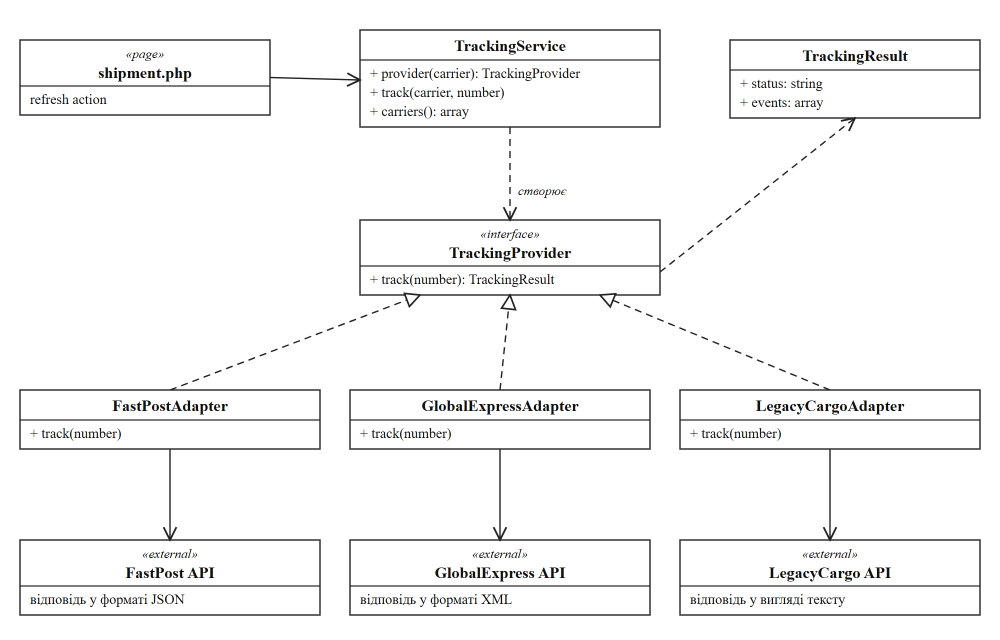
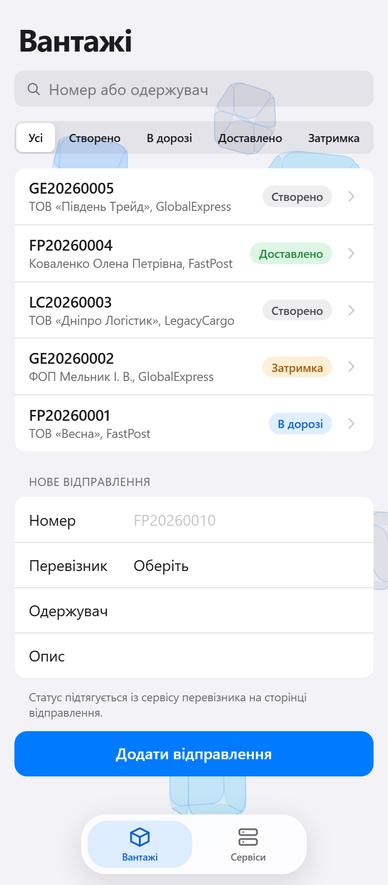
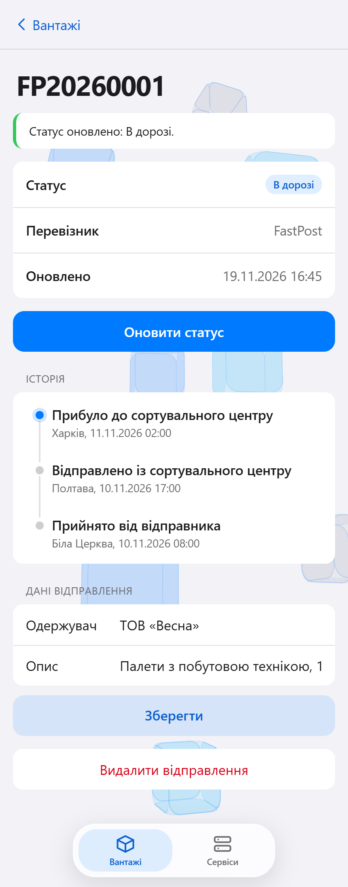
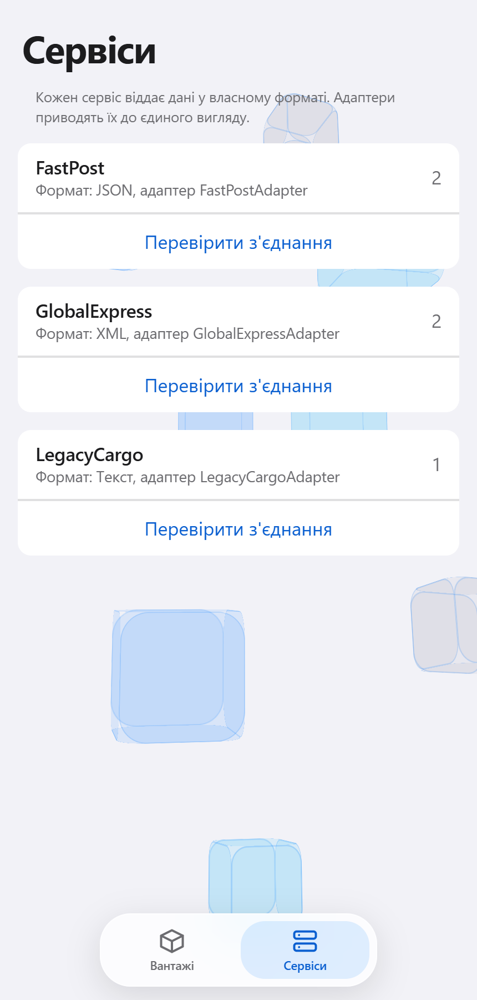

# Отслеживание грузов

Практическая работа №8 по дисциплине «Программирование Интернет», вариант 18. Веб-приложение логистической компании на PHP с базой данных PostgreSQL, которое получает статусы грузов у внешних сервисов. Оформлено в стиле iOS.

## Идея

Каждый перевозчик отдаёт данные в своём формате. FastPost присылает JSON, GlobalExpress отдаёт XML, а LegacyCargo обычный текст. Чтобы страницы не знали об этих различиях, для каждого сервиса написан адаптер. Все адаптеры реализуют общий интерфейс `TrackingProvider` и возвращают единый результат, а нужный адаптер выбирает класс `TrackingService`.

Внешние сервисы имитируются файлами в папке `api/`, поэтому приложению не нужен интернет.

## Что умеет

Отправления можно добавлять, смотреть, менять и удалять. Статус и история обновляются кнопкой на странице отправления. Есть поиск по номеру и получателю, фильтр по статусу и проверка связи с каждым сервисом. Данные читаются методом GET, меняются через POST, запросы к базе подготовленные, поля проверяются на сервере.

## Запуск

Нужен Docker.

```
docker compose up -d
```

Сайт откроется на http://localhost:8081. Для сброса данных:

```
docker compose down -v
```

## Структура

| Файл | Назначение |
| --- | --- |
| `index.php` | список отправлений и форма добавления |
| `shipment.php` | карточка отправления и обновление статуса |
| `services.php` | подключённые сервисы |
| `src/` | интерфейс, адаптеры и `TrackingService` |
| `api/` | имитация внешних сервисов |
| `schema.sql` | таблица и тестовые данные |

## UML-диаграмма



## Скриншоты

<p>
  
  
  
</p>
<p>
  
  
</p>
